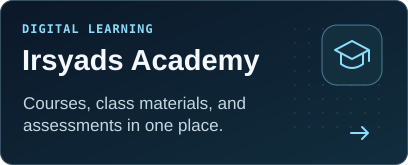
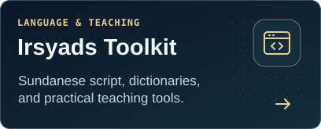
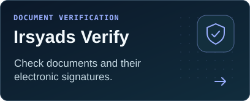
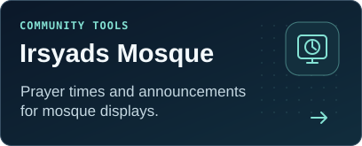

<p align="center">
  
  <a href="https://github.com/irsyadmsk?tab=followers"></a>
  <a href="https://github.com/irsyadmsk?tab=repositories"></a>
</p>

# Muhammad Irsyad Sirojul Khoeir, S.Sos., M.Sos., C.PS.

**Founder of Irsyads · Curriculum Lead · Sociology Teacher · Adjunct Lecturer**

I lead curriculum and teach sociology at MA Insan Cendekia Nusantara. I also lecture in Islamic communication and broadcasting and build tools for schools and madrasahs through [Irsyads](https://irsyads.com/).

[**Academic CV**](https://irsyads.com/cv) · [**Publications**](https://irsyads.com/library) · [**Certificates**](https://irsyads.com/certificates)

## About me

```yaml
name: Muhammad Irsyad Sirojul Khoeir
username: irsyadmsk
credentials: [S.Sos., M.Sos., C.PS.]
location: Indonesia
current_roles: [Founder of Irsyads, Curriculum Lead, Sociology Teacher, Adjunct Lecturer]
education:
  - S.Sos. in Islamic Communication and Broadcasting
  - M.Sos. in Islamic Communication and Broadcasting
honors: "Cum laude, M.Sos. | GPA 3.92/4.00"
certifications:
  - Certified Professional Public Speaker (C.PS.)
  - Gemini Certified Educator
research:
  - Sociology of religion
  - Prophetic rhetoric
  - Digital literacy
```

## Tech stack

| Web | Android & cross-platform | Tools & deployment |
| :---: | :---: | :---: |
|  |  |  |
| HTML · CSS · JavaScript · TypeScript | Kotlin · Dart · Flutter | Git · GitHub · Cloudflare |

## Featured projects

<table width="100%">
<tr>
<td width="50%" valign="top" align="center"><a href="https://curriculum.irsyads.com/"></a><br><a href="https://github.com/irsyadmsk/curriculum-maicn">GitHub repository</a> · <a href="https://curriculum.irsyads.com/">Open project ↗</a></td>
<td width="50%" valign="top" align="center"><a href="https://academy.irsyads.com/"></a><br><a href="https://academy.irsyads.com/">Open project ↗</a></td>
</tr>
<tr>
<td width="50%" valign="top" align="center"><a href="https://app.irsyads.com/"></a><br><a href="https://app.irsyads.com/">Open project ↗</a></td>
<td width="50%" valign="top" align="center"><a href="https://verify.irsyads.com/"></a><br><a href="https://verify.irsyads.com/">Open project ↗</a></td>
</tr>
<tr>
<td width="50%" valign="top" align="center"><a href="https://letters.irsyads.com/"></a><br><a href="https://letters.irsyads.com/">Open project ↗</a></td>
<td width="50%" valign="top" align="center"><a href="https://mosque.irsyads.com/"></a><br><a href="https://github.com/irsyadmsk/masjidku-downloads">GitHub repository</a> · <a href="https://mosque.irsyads.com/">Open project ↗</a></td>
</tr>
</table>

## GitHub stats

<p align="center"></p>

<p align="center">
  
  
  
  
</p>

## Activity graph

[](https://github.com/irsyadmsk#contribution-activity)

## Selected research and writing

- Co-authored *Emojipedia Budaya*, a book on nonverbal culture and Islamic values in the digital era (2024).
- Co-authored a participatory action research study on community-led digitalization in Cihanjawar (2024).
- Wrote a master's thesis on prophetic rhetoric in the da'wah of Mama Cianting (2025).

## Connect

[](mailto:hello@irsyads.com)
[](https://www.linkedin.com/in/irsyadskhoeir)
[](https://scholar.google.com/citations?user=n9OUUN0AAAAJ)
[](https://irsyads.com/)
